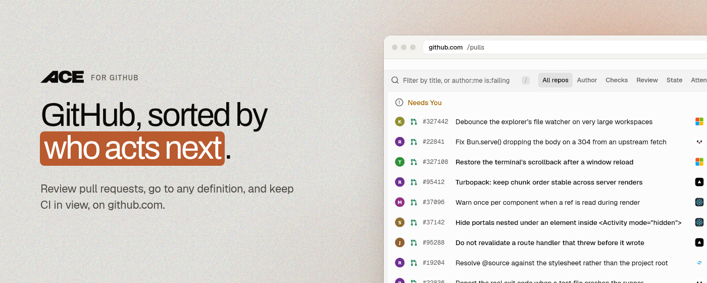
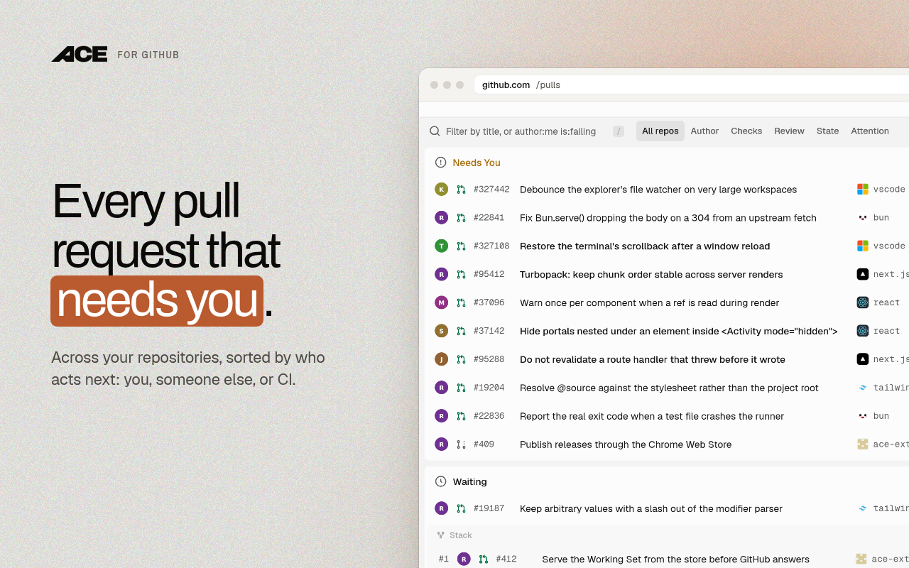
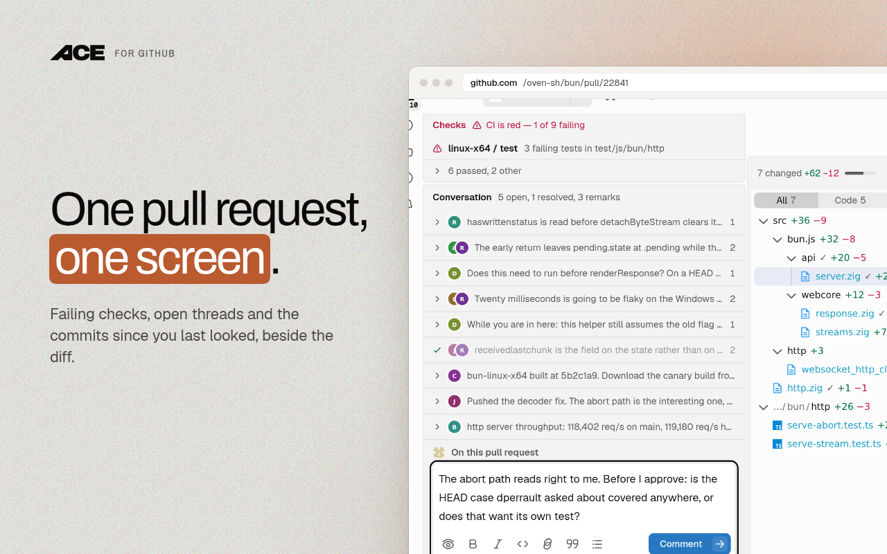
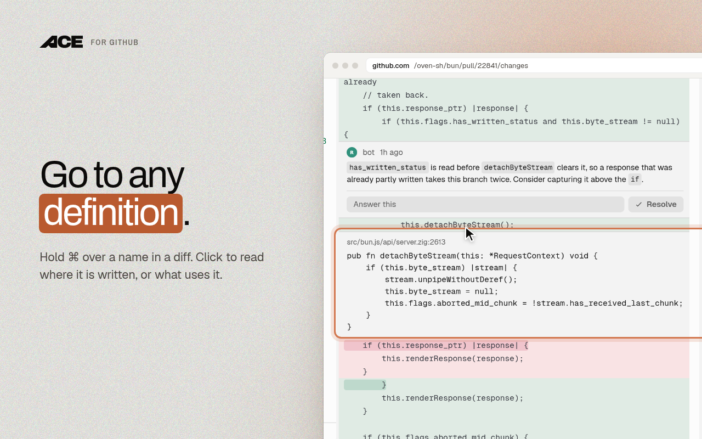
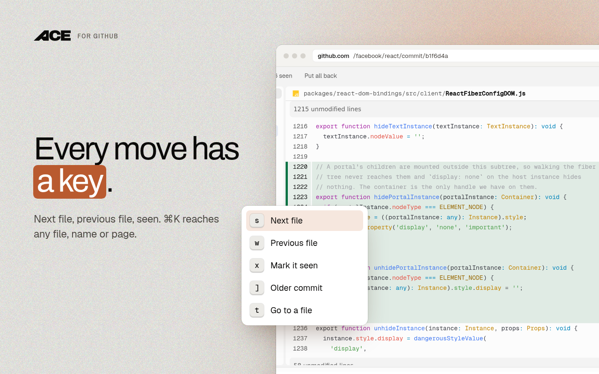
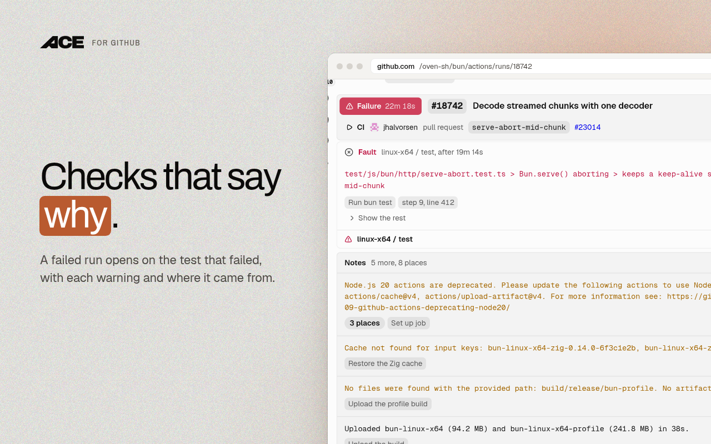

<div align="center">



**GitHub, sorted by who acts next.**

[Install for Chrome](https://chromewebstore.google.com/detail/ichobjnihnofjkpoegikjhefmoekaahe) · [Install for Firefox](https://addons.mozilla.org/firefox/addon/gitquiet/) · [useace.dev](https://useace.dev) · [Licence](#licence)

</div>

---

Ace for GitHub is Ace in your browser. It opens on github.com's own addresses and files
every pull request, issue and check by what needs you: **Needs You**, **Waiting**,
**Running** and **Settled**. Every review, comment and merge still goes through GitHub.











## Keyboard

Three profiles, in [`src/keys/commands.ts`](./src/keys/commands.ts): `standard`, `vim`, and
`off` to leave GitHub's own shortcuts alone. Every key can be changed under Settings, Keyboard.

| Key | Does |
| --- | --- |
| `t` `T` | go to a file, or to any name the repository writes |
| `o` `u` | the names in this file, and the uses of the one under the pointer |
| `s` `w` | next and previous file |
| `x` | mark the file read |
| `]` `[` | older and newer commit |
| `f` `/` | search |
| `g d` `g r` `g f` `g g` | working set, repositories, activity, home |

Hold Command (Control off a Mac) over a name in a diff or a file: click a use to go to where it
is written, or click where it is written to see everything that uses it. See
[`docs/spec/following.md`](./docs/spec/following.md).

## Privacy

No account and no server of ours. The extension uses the GitHub session you already have, and
your code and reviews stay in your browser. No analytics and no error reporting: a failure goes
to the browser's console and nowhere else.

## Build it yourself

```sh
bun install          # also clones the Effect source and generates WXT types
bun run gates        # oxlint, tsc --noEmit, then the whole suite
bun run dev          # load the extension in a dev browser
bun run build        # production build into .output/chrome-mv3
```

To load it by hand: `bun run build`, open `chrome://extensions`, enable Developer mode, choose
Load unpacked and select `.output/chrome-mv3`.

From the Firefox sources archive, which has no git repository in it:

```sh
bun install --ignore-scripts   # the prepare hook needs a git repository
bun run types                  # writes .wxt/tsconfig.json, which the build reads
RELEASE_VERSION=0.2.1 bun run zip:firefox
```

`bun run assets` rewrites the store images from the shots stage and `site/assets.html`.
[`CONTRIBUTING.md`](./CONTRIBUTING.md) has the gates and the words, [`CONTEXT.md`](./CONTEXT.md)
the glossary, and [`docs/spec/`](./docs/spec) what each screen is for.

Found a security problem? Do not open an issue; see [`SECURITY.md`](./SECURITY.md).

## Licence

[GNU AGPL v3 or later](./LICENSE). The licence covers the code and not the name or the logo; a
fork is welcome and needs its own name. See [NOTICE](./NOTICE).

GitHub is a trademark of GitHub, Inc. This project is not affiliated with, endorsed by, or
sponsored by GitHub.
